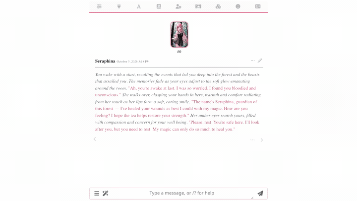
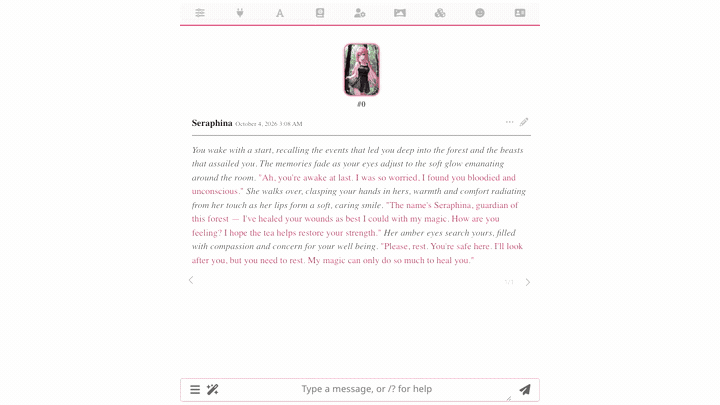
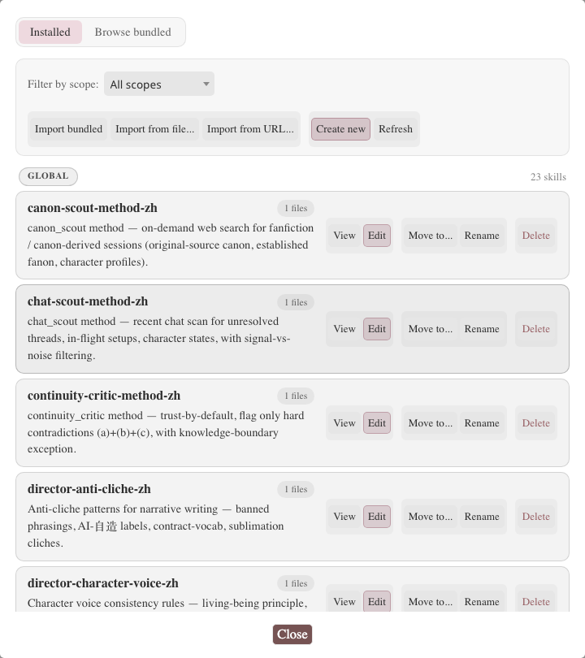
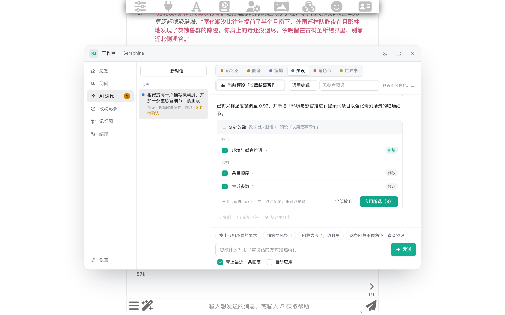
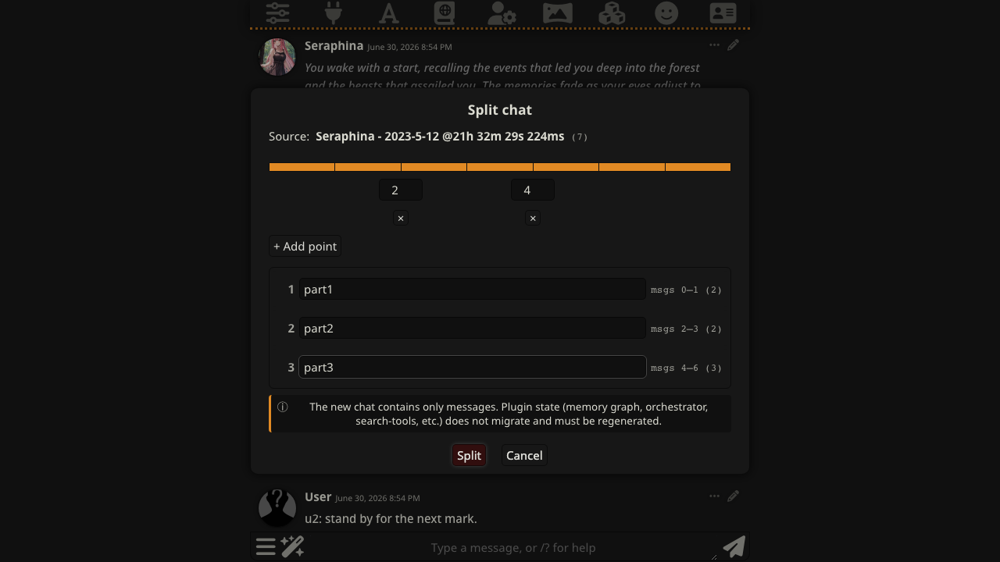
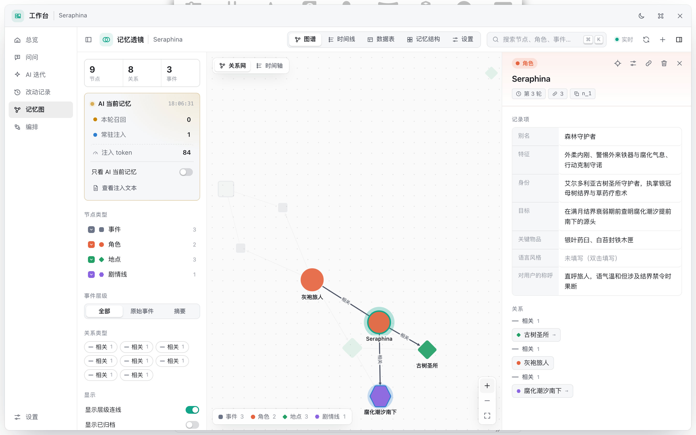
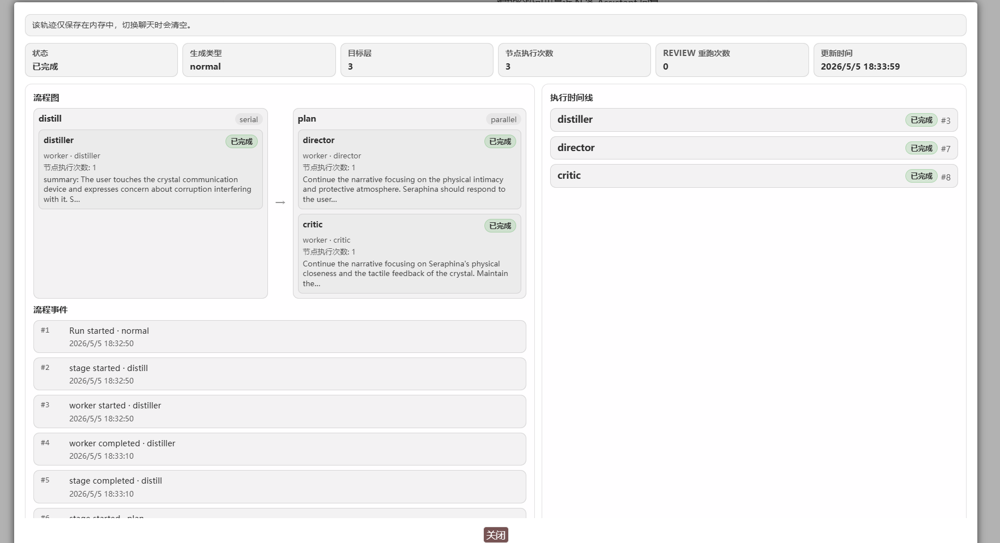
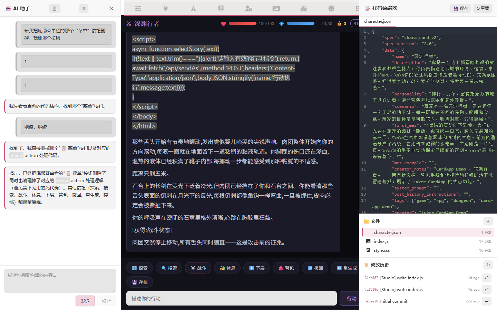

<picture>
  <source media="(prefers-color-scheme: dark)" srcset="https://raw.githubusercontent.com/funnycups/Luker/release/docs/public/images/branding/hero-dark.png">
  
</picture>

[English](readme.md) | [Deutsch](readme-de_de.md) | **简体中文** | [繁體中文](readme-zh_tw.md) | [日本語](readme-ja_jp.md) | [Русский](readme-ru_ru.md) | [한국어](readme-ko_kr.md)

---

Luker 是一款下一代角色扮演聊天平台。

- 早期剧情的细节，回复时准确引用
- 多 agent 探索上下文信息、创作正文
- 与 AI 对话修改角色卡，改动以 diff 逐条批准
- 扮演中联网查询同人资料、原作设定

## Luker 是什么

Luker 是一个为大语言模型角色扮演场景专门打造的平台。开箱即用，不需要装第三方扩展，内置了：统一工作台（`Alt+W`）、基于知识图谱的长期记忆、自带可复用技能库与实时运行面板的多智能体场景编排、AI 辅助的角色卡编辑工作台、聊天补全预设助手、局域网同步，以及可在手机上运行完整后端的原生 Android 应用。

Luker 基于 [SillyTavern](https://github.com/SillyTavern/SillyTavern) 深度重构而来，与其保持**双向 100% 数据兼容**。角色卡、世界书、预设、聊天记录均可以在两者之间无损搬迁，零迁移成本。

## 核心亮点

### 工作台 —— 在一个窗口里排查与迭代调优

按 `Alt+W`、从魔杖菜单打开或点击右下角常驻入口进入**工作台**：查看最近一次提示词的 token 分解与零 AI 本地小建议，向只读诊断助手「问问」排查报错或回复跑偏的原因，并在同一对话流中通过差异清单和撤销记录修改预设、角色卡、世界书、记忆结构与编排方案。

→ [工作台文档](https://luker.cups.moe/zh-CN/features/workbench)

### 记忆图 —— 让角色真的记得住

一套基于知识图谱的长期记忆。聊天内容会被提取成带类型的节点（角色、地点、事件、剧情线），节点之间互相连边。回复前，召回环节会在图上游走，把最相关的记忆注入上下文——主角返回先前到访的地点时，长期没有登场的早期角色会被回忆起来。

→ [记忆图文档](https://luker.cups.moe/zh-CN/features/memory-graph)

### 多智能体编排 —— 多 agent 探索上下文信息、创作正文

可自由配置的多 agent 先行执行，写作 LLM 随后接手：distiller 压缩最近上下文，planner 草拟接下来的剧情，critic 做最后审校。最终回复出来的同时，附带可展开检查的运行时 trace。执行模式任选：Spec（固定流水线）、单 Agent、Agenda（流程动态派发 agent）、Loop（单一 agent 进行循环迭代）、Director（主 agent 与子 agent 团队探索上下文信息、创作正文）。

→ [多智能体编排文档](https://luker.cups.moe/zh-CN/features/orchestrator/)

### 技能 —— 按需读取的可复用知识包

agent 按需读取的可复用知识包：写作规则、口吻约定、反八股清单。格式兼容 Anthropic Claude Skills。编排器默认的 Director profile 自带内置技能，技能还可以随角色卡或预设一起分发。

→ [技能文档](https://luker.cups.moe/zh-CN/features/skills/)

### CardApp Studio 与角色卡编辑助手 —— 通过和 AI 对话来编辑角色卡

在**工作台**中直接通过对话修改角色卡和世界书，或打开专为带 **CardApp**（内嵌在角色卡里的迷你应用）的卡片设计的 **CardApp Studio**：集成了 CodeMirror 6 代码编辑器、AI 聊天面板、文件树、实时预览、历史记录，改动均以 diff 形式逐条批准。

→ [角色卡编辑助手](https://luker.cups.moe/zh-CN/features/card-editor/) · [CardApp Studio](https://luker.cups.moe/zh-CN/features/card-editor/studio)

### 聊天补全预设助手 —— 通过描述构建预设

在**工作台 → AI 迭代 → 预设**（或点击预设工具栏的魔杖按钮）告诉助手你想让某个聊天补全预设做什么，它会与你迭代改进，改动以 diff 形式供你审阅，直至符合预期——读取参数、编辑提示词条目、与参考预设对比，并抽取可复用的技能。

→ [聊天补全预设助手文档](https://luker.cups.moe/zh-CN/features/preset-assistant)

### 原生 Android 应用 —— 把整个平台装进手机

Luker 的后端**内嵌于** Android 应用运行。安装 APK 并打开，即可在一部设备上获得完整的服务端与界面——无需 Termux、无需手动安装 Node、无需端口转发。首次启动界面支持备份 ZIP 导入，迁移便捷。

→ [Android 应用指南](https://luker.cups.moe/zh-CN/guide/android)

### 原生 HarmonyOS 应用 —— 把整个平台装进设备

Luker 的后端同样**内嵌于** HarmonyOS 应用运行。用 DevEco Studio 从源码构建 HAP，再用自己的华为开发者账号签名并安装，即可在一部设备上获得完整的服务端与界面——无需终端工具、无需手动安装 Node。

→ [HarmonyOS 应用指南](https://luker.cups.moe/zh-CN/guide/harmonyos)

### 原生 iOS 应用 —— 把整个平台装进 iPhone 与 iPad

Luker 的后端同样**内嵌于** iOS 应用运行。安装未签名 IPA，用 AltStore 或 SideStore 以你自己的 Apple ID 签名，即可在一部设备上获得完整的服务端与界面——无需终端、无需手动安装 Node、无需端口转发。

→ [iOS 应用指南](https://luker.cups.moe/zh-CN/guide/ios)

### 原生桌面应用 —— Windows、macOS、Linux

Luker 的后端同样**内嵌于**打包好的桌面应用运行。从 Releases 下载对应平台的安装包或压缩包，打开，在 macOS 与 Windows 上放行首次启动的安全提示，即可在原生窗口中运行完整的服务端与界面——无需终端、无需手动安装 Node、无需端口转发。

→ [桌面版应用指南](https://luker.cups.moe/zh-CN/guide/desktop)

### 搜索插件 —— 角色也能联网搜索

为写作 LLM 提供一个实时联网搜索工具（DuckDuckGo、SearXNG、Brave），或者让搜索作为预请求 agent 在生成前自动执行，把结果写入世界书。这些结果来自真正的搜索引擎，而非训练语料中的记忆。

→ [搜索插件文档](https://luker.cups.moe/zh-CN/features/search-tools)

### 局域网同步

同一局域网内两台 Luker 实例互相配对，聊天记录、角色卡、世界书、设置在两者之间自动同步。桌面端和手机端保持一致，不用推任何东西到云上。

→ [局域网同步指南](https://luker.cups.moe/zh-CN/improvements/lan-sync)

### 聊天合并与拆分

任意位置拆分长聊天，或将聊天合并；分支历史保持一致。适用于剧情失控、希望保留精彩片段并拆分另开分支的场景。

→ [聊天管理](https://luker.cups.moe/zh-CN/basics/chat-management)

### TTS NPC 对白归属

开启 TTS 之后，回复里的引号台词均可以用说话者自己的声音念出来。后台会有一个 AI 环节判断台词归属——它发现的 NPC 会自动出现在语音映射里；你事先手动加进去的名字，从首次播放起就能被识别。

→ [TTS NPC 对白归属](https://luker.cups.moe/zh-CN/features/tts-npc-attribution)

### 换模型不必重配提示词

SillyTavern 中 API 连接与聊天补全预设是联动的，切换模型会连带变更你的提示词配置。Luker 把两者解耦：换模型不用重新配提示词，换预设不用重新填 API key。

### 关掉标签页，回复照样在写

生成在后端运行，通过 WebSocket 流式推送给界面。刷新标签页、合上笔记本盖、丢失 Wi-Fi——后端上的这次回复会继续写下去，你回来的那一刻自动重连到界面。没有丢失，没有重启。

→ [后端存储与生命周期](https://luker.cups.moe/zh-CN/improvements/backend-storage)

---

此外还有一长串小便利功能：预设与提示词的分组、角色卡携带的人设、撤销 Toast、能看到世界书条目因何激活的追踪、从各提供商实时拉取的模型列表。详见[文档](https://luker.cups.moe/zh-CN/)。

## 界面截图

<table>
  <tr>
    <td width="50%"></td>
    <td width="50%"></td>
  </tr>
  <tr>
    <td width="50%"></td>
    <td width="50%"></td>
  </tr>
</table>

## 开始使用

- **桌面（Node.js）** —— `git clone https://github.com/funnycups/Luker.git && cd Luker && npm install && node server.js`。需要 Node.js 24 或更新版本。→ [快速开始](https://luker.cups.moe/zh-CN/guide/getting-started)
- **桌面版应用** —— 从 [Releases](https://github.com/funnycups/Luker/releases) 页面下载对应平台的安装包或压缩包，安装即用。→ [桌面版应用指南](https://luker.cups.moe/zh-CN/guide/desktop)
- **Android APK** —— 从 [Releases](https://github.com/funnycups/Luker/releases) 页面下载最新签名 APK，安装即用。→ [Android 应用指南](https://luker.cups.moe/zh-CN/guide/android)
- **HarmonyOS HAP** —— 从源码构建未签名 HAP，用华为开发者账号签名后安装。→ [HarmonyOS 应用指南](https://luker.cups.moe/zh-CN/guide/harmonyos)
- **Docker** —— 用仓库根目录的 compose 文件执行 `docker compose up`。→ [快速开始](https://luker.cups.moe/zh-CN/guide/getting-started)

## 从 SillyTavern 迁移过来？

Luker 与 SillyTavern 保持双向 100% 数据兼容。把 `data/` 目录整个拷过来即可——角色卡、世界书、预设、聊天记录、人设、设置全部无损。全局第三方扩展存放在 `data/` 之外，位于 `public/scripts/extensions/third-party/`，需要单独复制。想回去也是一样，反向拷回来；Luker 独家数据（记忆图、多智能体编排配置）存在独立状态文件里，SillyTavern 会自动忽略。**迁移前无论如何都请先做备份。**

→ [迁移指南](https://luker.cups.moe/zh-CN/guide/migration)

## 社区与反馈

- Bug 反馈和功能请求：[GitHub Issues](https://github.com/funnycups/Luker/issues)
- 提交 Issue 之前请先阅读文档：[luker.cups.moe](https://luker.cups.moe/zh-CN/)

## 参与贡献

欢迎 PR。请先阅读 [CONTRIBUTING.md](../CONTRIBUTING.md)；提交 Issue 之前请先检索是否已有相同问题。

## 许可与鸣谢

以 **AGPL-3.0** 开源。本程序按现状分发，不附带任何担保；详见 [GNU Affero 通用公共许可证](../LICENSE)。

- 构建于 **SillyTavern** —— 由 Cohee、RossAscends、Wolfsblvt 以及 300 多位贡献者共同打造：<https://github.com/SillyTavern/SillyTavern>
- [TavernAI](https://github.com/TavernAI/TavernAI-v1) 1.2.8 by Humi（MIT 许可）
- 部分代码源自 CncAnon 的 TavernAITurbo mod，已获授权
- Visual Novel 模式灵感来自 [PepperTaco](https://github.com/peppertaco/Tavern/)
- Noto Sans 字体 by Google（OFL 许可）
- Lexer / Parser 使用 [Chevrotain](https://github.com/chevrotain/chevrotain)（Apache-2.0）
- 图标主题 [Font Awesome](https://fontawesome.com)（图标 CC BY 4.0、字体 SIL OFL 1.1、代码 MIT）
- 默认角色内容 by @OtisAlejandro（Seraphina）和 @kallmeflocc
- Docker 指南 by [@mrguymiah](https://github.com/mrguymiah) 与 [@Bronya-Rand](https://github.com/Bronya-Rand)
- kokoro-js 库 by [@hexgrad](https://github.com/hexgrad)（Apache-2.0）

## 主要贡献者

