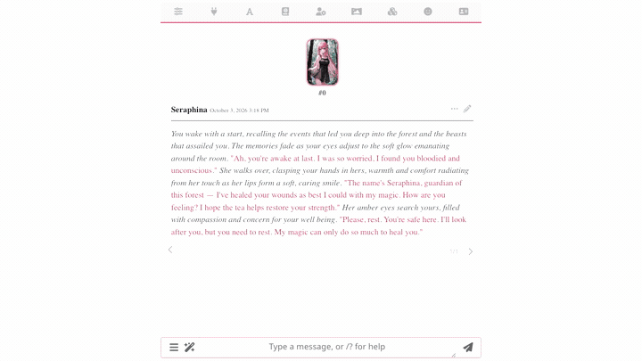
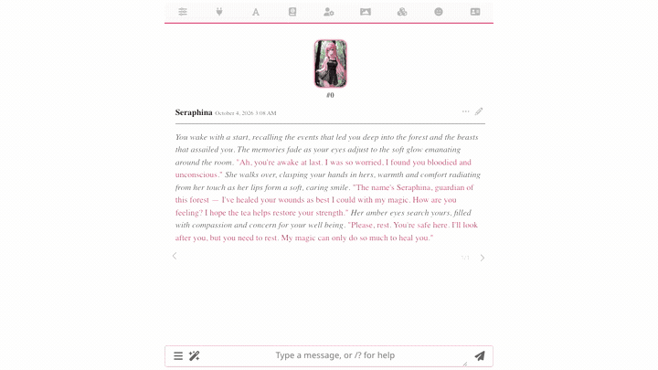
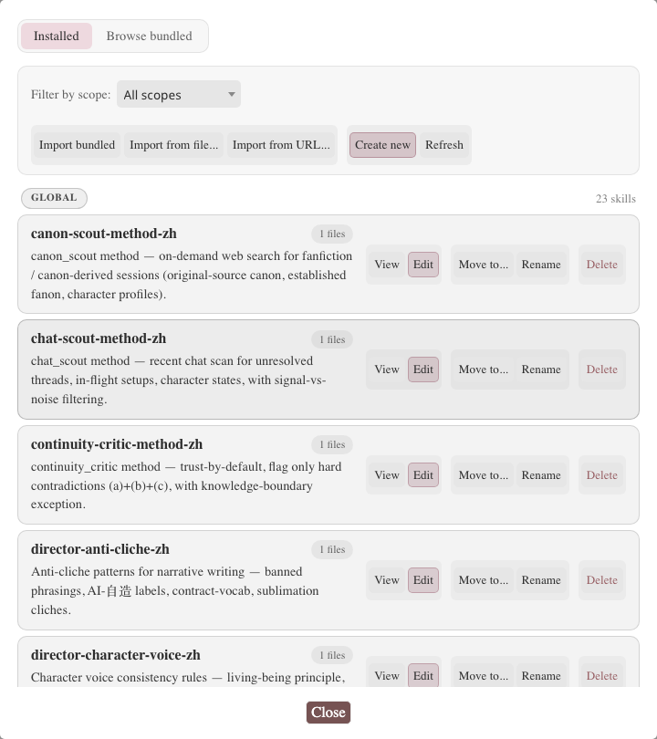
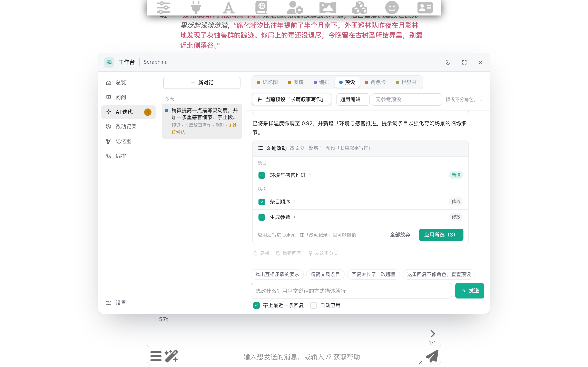
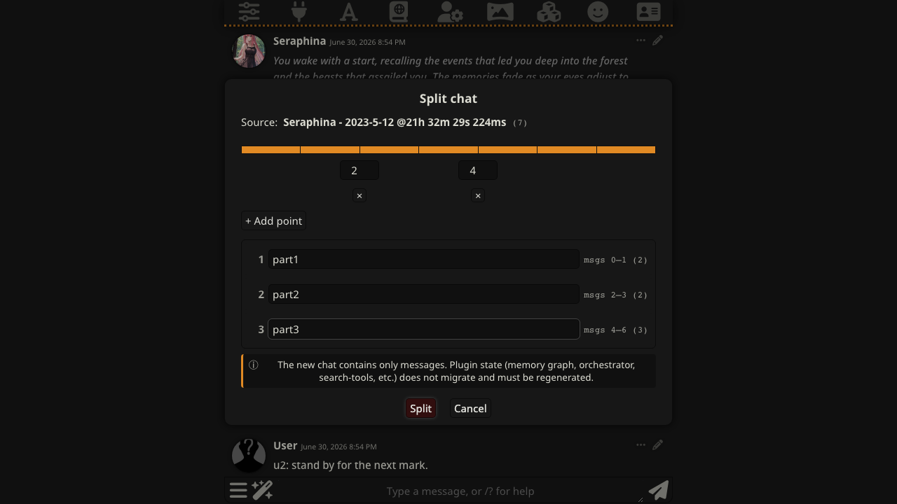
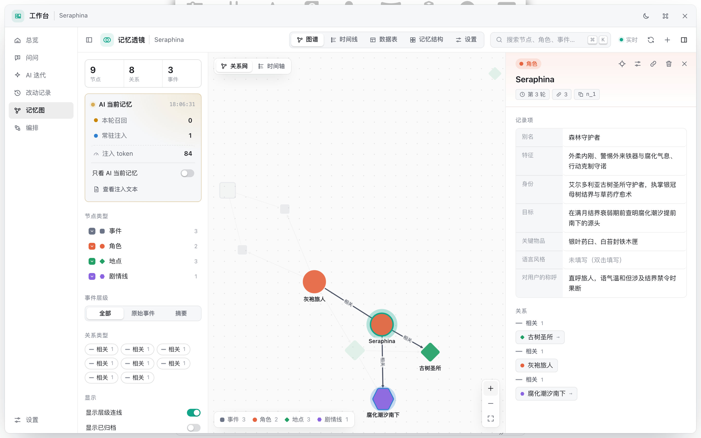
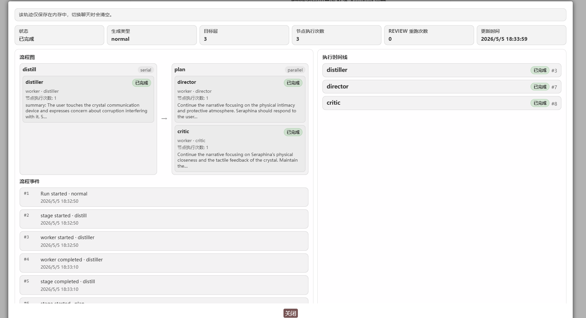
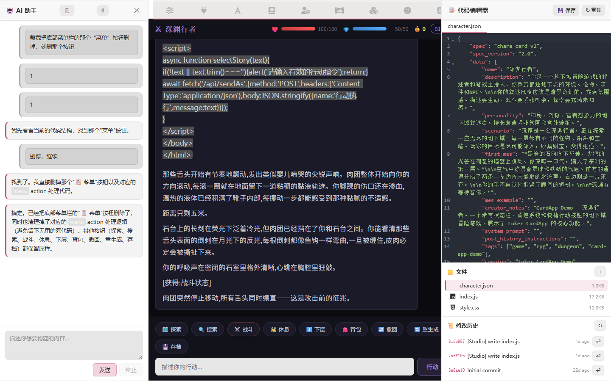

<picture>
  <source media="(prefers-color-scheme: dark)" srcset="https://raw.githubusercontent.com/funnycups/Luker/release/docs/public/images/branding/hero-dark.png">
  
</picture>

[English](readme.md) | [Deutsch](readme-de_de.md) | [简体中文](readme-zh_cn.md) | **繁體中文** | [日本語](readme-ja_jp.md) | [Русский](readme-ru_ru.md) | [한국어](readme-ko_kr.md)

---

Luker 是一款下一代角色扮演聊天平台。

- 早期劇情的細節，回覆時準確引用
- 多 agent 探索上下文資訊、創作正文
- 與 AI 對話修改角色卡，改動以 diff 逐條批准
- 扮演中聯網查詢同人資料、原作設定

## Luker 是什麼

Luker 是一個為大型語言模型角色扮演場景專門打造的平台。開箱即用，不需要裝第三方擴充，內建了：統一工作台（`Alt+W`）、基於知識圖譜的長期記憶、自帶可重用技能庫與即時執行面板的多 Agent 場景編排、AI 輔助的角色卡編輯工作台、聊天補全預設助手、區域網路同步，以及可在手機上執行完整後端的原生 Android 應用。

Luker 基於 [SillyTavern](https://github.com/SillyTavern/SillyTavern) 深度重構而來，與其保持**雙向 100% 資料相容**。角色卡、世界書、預設、聊天記錄均可以在兩者之間無損搬遷，零遷移成本。

## 核心亮點

### 工作台 —— 在同一個視窗裡排查與迭代調優

按 `Alt+W`、從魔杖選單開啟或點擊右下角常駐入口進入**工作台**：檢視最近一次提示詞的 token 分解與零 AI 本機小建議，向唯讀診斷助手「問問」排查報錯或回覆跑偏的原因，並在同一對話流中透過差異清單和復原記錄修改預設、角色卡、世界書、記憶結構與編排方案。

→ [工作台文件](https://luker.cups.moe/zh-TW/features/workbench)

### 記憶圖 —— 讓角色真的記得住

一套基於知識圖譜的長期記憶。聊天內容會被提取成帶類型的節點（角色、地點、事件、劇情線），節點之間互相連邊。回覆前，召回環節會在圖上游走，把最相關的記憶注入上下文——主角返回先前到訪的地點時，長期沒有登場的早期角色會被回憶起來。

→ [記憶圖文件](https://luker.cups.moe/zh-TW/features/memory-graph)

### 多 Agent 編排 —— 多 agent 探索上下文資訊、創作正文

可自由配置的多 agent 先行執行，創作 LLM 隨後接手：distiller 壓縮最近上下文，planner 草擬接下來的劇情，critic 做最後審校。最終回覆出來的同時，附帶可展開檢查的執行時 trace。執行模式任選：Spec（固定流水線）、單 Agent、Agenda（流程動態派發 agent）、Loop（單一 agent 進行迴圈迭代）、Director（主 agent 與子 agent 團隊探索上下文資訊、創作正文）。

→ [多 Agent 編排文件](https://luker.cups.moe/zh-TW/features/orchestrator/)

### 技能 —— 按需讀取的可重用知識包

agent 按需讀取的可重用知識包：寫作規則、口吻約定、反八股清單。格式相容 Anthropic Claude Skills。編排器預設的 Director profile 自帶內建技能，技能也可以隨角色卡或預設一起分發。

→ [技能文件](https://luker.cups.moe/zh-TW/features/skills/)

### CardApp Studio 與角色卡編輯助手 —— 透過和 AI 對話來編輯角色卡

在**工作台**中直接透過對話修改角色卡和世界書，或開啟專為帶 **CardApp**（內嵌在角色卡裡的迷你應用）的卡片設計的 **CardApp Studio**：整合了 CodeMirror 6 程式碼編輯器、AI 聊天面板、檔案樹、即時預覽、歷史記錄，改動均以 diff 形式逐條批准。

→ [角色卡編輯助手](https://luker.cups.moe/zh-TW/features/card-editor/) · [CardApp Studio](https://luker.cups.moe/zh-TW/features/card-editor/studio)

### 聊天補全預設助手 —— 透過描述構建預設

在**工作台 → AI 迭代 → 預設設定檔**（或點擊預設工具列的魔杖按鈕）告訴助手你想讓某個聊天補全預設做什麼，它會與你迭代改進，改動以 diff 形式供你審閱，直至符合預期——讀取參數、編輯提示詞條目、與參考預設對比，並抽取可重用的技能。

→ [聊天補全預設助手文件](https://luker.cups.moe/zh-TW/features/preset-assistant)

### 原生 Android 應用 —— 把整個平台裝進手機

Luker 的後端**內嵌於** Android 應用執行。安裝 APK 並打開，即可在一部裝置上獲得完整的伺服端與介面——無需 Termux、無需手動安裝 Node、無需連接埠轉送。首次啟動畫面支援備份 ZIP 匯入，遷移便捷。

→ [Android 應用指南](https://luker.cups.moe/zh-TW/guide/android)

### 原生 HarmonyOS 應用 —— 把整個平台裝進裝置

Luker 的後端同樣**內嵌於** HarmonyOS 應用執行。用 DevEco Studio 從原始碼建置 HAP，再用自己的華為開發者帳號簽名並安裝，即可在一部裝置上獲得完整的伺服器端與介面——無需終端工具、無需手動安裝 Node。

→ [HarmonyOS 應用指南](https://luker.cups.moe/zh-TW/guide/harmonyos)

### 原生 iOS 應用程式 —— 把整個平台裝進 iPhone 與 iPad

Luker 的後端同樣**內嵌於** iOS 應用程式執行。安裝未簽名 IPA，用 AltStore 或 SideStore 以自己的 Apple ID 簽名，即可在一部裝置上獲得完整的伺服器端與介面——無需終端、無需手動安裝 Node、無需連接埠轉送。

→ [iOS 應用程式指南](https://luker.cups.moe/zh-TW/guide/ios)

### 原生桌面應用 —— Windows、macOS、Linux

Luker 的後端同樣**內嵌於**打包好的桌面應用執行。從 Releases 下載對應平台的安裝包或壓縮包，開啟，在 macOS 與 Windows 上放行首次啟動的安全提示，即可在原生視窗中執行完整的伺服器端與介面——無需終端、無需手動安裝 Node、無需連接埠轉送。

→ [桌面版應用指南](https://luker.cups.moe/zh-TW/guide/desktop)

### 搜尋外掛 —— 角色也能聯網搜尋

為寫作 LLM 提供一個即時聯網搜尋工具（DuckDuckGo、SearXNG、Brave），或者讓搜尋作為預請求 agent 在生成前自動執行，把結果寫入世界書。這些結果來自真正的搜尋引擎，而非訓練語料中的記憶。

→ [搜尋外掛文件](https://luker.cups.moe/zh-TW/features/search-tools)

### 區域網路同步

同一區域網路內兩台 Luker 實例互相配對，聊天記錄、角色卡、世界書、設定在兩者之間自動同步。桌面端和手機端保持一致，不用推任何東西到雲上。

→ [區域網路同步指南](https://luker.cups.moe/zh-TW/improvements/lan-sync)

### 聊天合併與拆分

任意位置拆分長聊天，或將聊天合併；分支歷史保持一致。適用於劇情失控、希望保留精彩片段並拆分另開分支的場景。

→ [聊天管理](https://luker.cups.moe/zh-TW/basics/chat-management)

### TTS NPC 對白歸屬

開啟 TTS 之後，回覆裡的引號台詞均可以用說話者自己的聲音唸出來。後台會有一個 AI 環節判斷台詞歸屬——它發現的 NPC 會自動出現在語音映射裡；你事先手動加進去的名字，從首次播放起就能被辨識。

→ [TTS NPC 對白歸屬](https://luker.cups.moe/zh-TW/features/tts-npc-attribution)

### 換模型不必重配提示詞

SillyTavern 中 API 連線與聊天補全預設是聯動的，切換模型會連帶變更你的提示詞設定。Luker 把兩者解耦：換模型不用重新配提示詞，換預設不用重新填 API key。

### 關掉分頁，回覆照樣在寫

生成在後端執行，透過 WebSocket 串流推送給介面。重新整理分頁、蓋上筆電、丟失 Wi-Fi——後端上的這次回覆會繼續寫下去，你回來的那一刻自動重連到介面。沒有丟失，沒有重啟。

→ [後端儲存與生命週期](https://luker.cups.moe/zh-TW/improvements/backend-storage)

---

此外還有一長串小便利功能：預設與提示詞的分組、角色卡攜帶的人設、復原 Toast、能看到世界書條目因何啟動的追蹤、從各提供商即時拉取的模型列表。詳見[文件](https://luker.cups.moe/zh-TW/)。

## 介面截圖

<table>
  <tr>
    <td width="50%"></td>
    <td width="50%"></td>
  </tr>
  <tr>
    <td width="50%"></td>
    <td width="50%"></td>
  </tr>
</table>

## 開始使用

- **桌面（Node.js）** —— `git clone https://github.com/funnycups/Luker.git && cd Luker && npm install && node server.js`。需要 Node.js 24 或更新版本。→ [快速開始](https://luker.cups.moe/zh-TW/guide/getting-started)
- **桌面版應用** —— 從 [Releases](https://github.com/funnycups/Luker/releases) 頁面下載對應平台的安裝包或壓縮包，安裝即用。→ [桌面版應用指南](https://luker.cups.moe/zh-TW/guide/desktop)
- **Android APK** —— 從 [Releases](https://github.com/funnycups/Luker/releases) 頁面下載最新簽名 APK，安裝即用。→ [Android 應用指南](https://luker.cups.moe/zh-TW/guide/android)
- **HarmonyOS HAP** —— 從原始碼建置未簽名 HAP，用華為開發者帳號簽名後安裝。→ [HarmonyOS 應用指南](https://luker.cups.moe/zh-TW/guide/harmonyos)
- **Docker** —— 用倉庫根目錄的 compose 檔案執行 `docker compose up`。→ [快速開始](https://luker.cups.moe/zh-TW/guide/getting-started)

## 從 SillyTavern 遷移過來？

Luker 與 SillyTavern 保持雙向 100% 資料相容。把 `data/` 目錄整個拷過來即可——角色卡、世界書、預設、聊天記錄、人設、設定全部無損。全域第三方擴充存放在 `data/` 之外，位於 `public/scripts/extensions/third-party/`，需要另外複製。想回去也是一樣，反向拷回來；Luker 獨家資料（記憶圖、多 Agent 編排設定）存在獨立狀態檔案裡，SillyTavern 會自動忽略。**遷移前無論如何都請先做備份。**

→ [遷移指南](https://luker.cups.moe/zh-TW/guide/migration)

## 社群與回饋

- Bug 回報和功能請求：[GitHub Issues](https://github.com/funnycups/Luker/issues)
- 提交 Issue 之前請先閱讀文件：[luker.cups.moe](https://luker.cups.moe/zh-TW/)

## 參與貢獻

歡迎 PR。請先閱讀 [CONTRIBUTING.md](../CONTRIBUTING.md)；提交 Issue 之前請先檢索是否已有相同問題。

## 授權與鳴謝

以 **AGPL-3.0** 開源。本程式按現狀分發，不附帶任何擔保；詳見 [GNU Affero 通用公共許可證](../LICENSE)。

- 建構於 **SillyTavern** —— 由 Cohee、RossAscends、Wolfsblvt 以及 300 多位貢獻者共同打造：<https://github.com/SillyTavern/SillyTavern>
- [TavernAI](https://github.com/TavernAI/TavernAI-v1) 1.2.8 by Humi（MIT 許可）
- 部分程式碼源自 CncAnon 的 TavernAITurbo mod，已獲授權
- Visual Novel 模式靈感來自 [PepperTaco](https://github.com/peppertaco/Tavern/)
- Noto Sans 字體 by Google（OFL 許可）
- Lexer / Parser 使用 [Chevrotain](https://github.com/chevrotain/chevrotain)（Apache-2.0）
- 圖示主題 [Font Awesome](https://fontawesome.com)（圖示 CC BY 4.0、字體 SIL OFL 1.1、程式碼 MIT）
- 預設角色內容 by @OtisAlejandro（Seraphina）和 @kallmeflocc
- Docker 指南 by [@mrguymiah](https://github.com/mrguymiah) 與 [@Bronya-Rand](https://github.com/Bronya-Rand)
- kokoro-js 函式庫 by [@hexgrad](https://github.com/hexgrad)（Apache-2.0）

## 主要貢獻者

